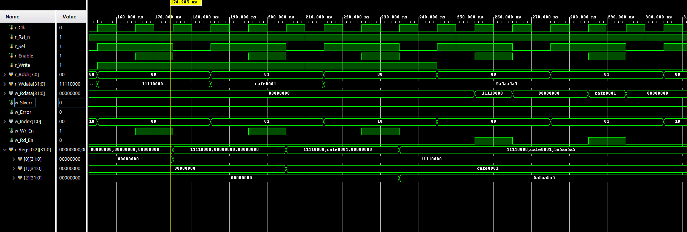
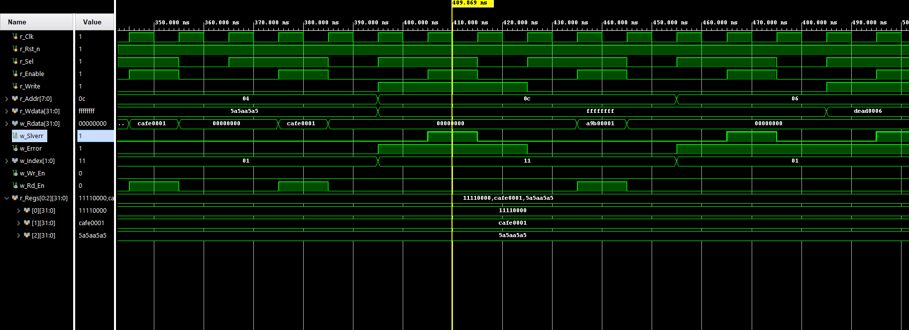
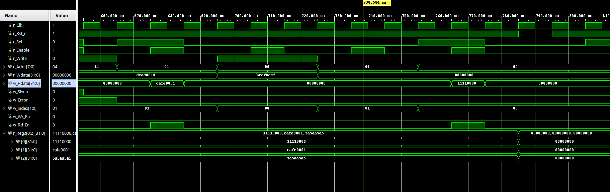
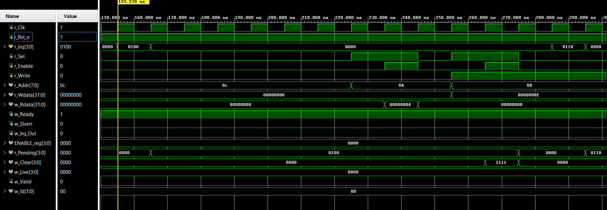
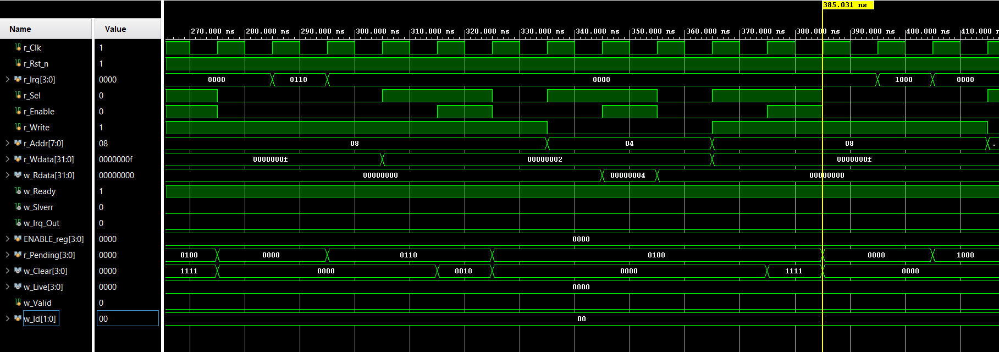
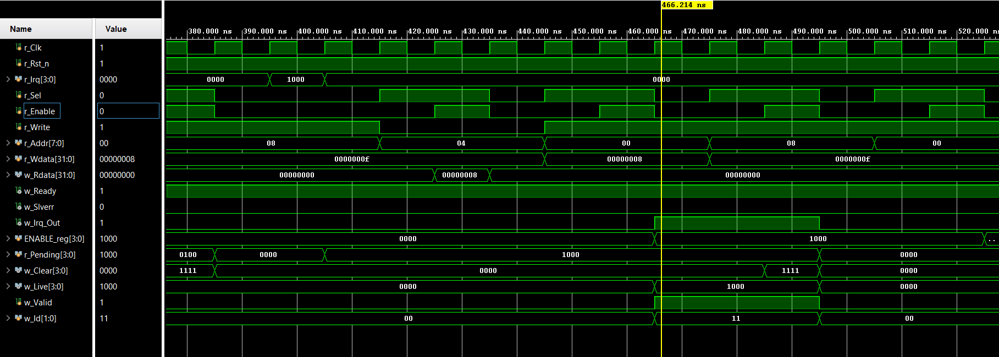
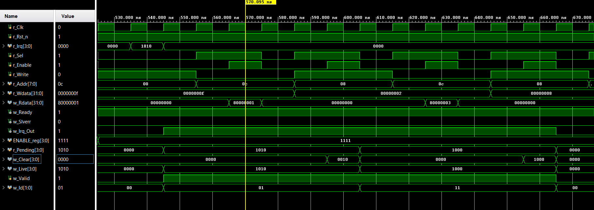

# APB Slave and Interrupt Controller in SystemVerilog

Two peripherals that a CPU would reach over an **AMBA APB** bus: a small register file and a
4-input interrupt controller. Both are written in SystemVerilog, verified with self-checking
testbenches that act as the CPU on the bus, and synthesized in Vivado for a Spartan-7 FPGA
(Digilent Arty S7-25).

The interrupt controller reuses the APB slave logic from the register file, so the bus
interface was written and tested once and then used again.


## Why APB and an interrupt controller?

A chip usually has one CPU and many small peripherals (UART, timers, GPIO, ...). The CPU
needs a simple way to write their settings and read their status. **APB** (Advanced
Peripheral Bus, part of Arm's AMBA family) is the simplest bus for that: one transfer at a
time, at least two clocks per transfer, no bursts.

Peripherals also need a way to tell the CPU that something happened, without the CPU
asking them over and over (polling). Each one raises an **interrupt** line. The CPU only has
one interrupt input, so an **interrupt controller** sits in between: it remembers which
sources have asked, lets the CPU turn sources on and off, picks which one to handle first,
and lets the CPU clear a request once it's handled.

## APB interface (shared by both blocks)

```
           SETUP   ACCESS
PSEL     __/‾‾‾‾‾‾‾‾‾‾‾‾‾‾\__
PENABLE  _________/‾‾‾‾‾‾‾\__
PADDR    --<  address      >--
PREADY   ‾‾‾‾‾‾‾‾‾‾‾‾‾‾‾‾‾‾‾‾   always 1 (no wait states)
                           ^
             write happens / read data captured here
```

- A transfer is a **SETUP** cycle (PSEL = 1, PENABLE = 0) followed by an **ACCESS** cycle
  (PENABLE = 1). It completes at the edge where PSEL, PENABLE and PREADY are all 1.
- **PSLVERR** goes high in the ACCESS cycle, and nothing is written, if:
  - the address is 0x10 or above,
  - the address is not aligned to a 32-bit register (bits [1:0] not 00),
  - it is a write to a read-only register.
- **PRDATA** is 0 except during a valid read. The read path is a combinational multiplexer,
  so the data is ready in the ACCESS cycle.
- A transfer with **PSEL = 0** is meant for another peripheral and is ignored.

## Register file (`design/apb_regs.sv`)

| Address | Name | Access | Reset |
|---|---|---|---|
| 0x00 | CTRL | RW | 0 |
| 0x04 | DATA0 | RW | 0 |
| 0x08 | DATA1 | RW | 0 |
| 0x0C | ID | RO | 0xA9B0_0001 |

Three 32-bit registers with an asynchronous active-low reset, plus a fixed ID value that
software can read to check the peripheral is there.

## Interrupt controller (`design/apb_irq_ctrl.sv`)

```
 i_Irq[3:0] ---> [ pending bits ] ──┐
                  ^ cleared by     AND ---> priority ---> ACTIVE (VALID, ID)
                  │ CLEAR writes   │
                [ ENABLE ] ────────┘ ──> OR ──> o_Irq
                  ^
                  └── written by the CPU over APB
```

| Address | Name | Access | Bits | Meaning |
|---|---|---|---|---|
| 0x00 | ENABLE | RW | [3:0] | 1 = interrupt allowed |
| 0x04 | STATUS | RO | [3:0] | interrupts waiting to be handled |
| 0x08 | CLEAR | WO | [3:0] | write 1 to clear a waiting interrupt, reads 0 |
| 0x0C | ACTIVE | RO | [31] VALID, [1:0] ID | the interrupt to handle first |

- A source sets its `i_Irq` bit to 1 for at least one clock. The request is stored in a
  **pending** bit, which stays set after the input goes back to 0 until the CPU clears it.
- **ENABLE** works as a mask. A disabled source is still recorded in STATUS but doesn't drive
  `o_Irq`. If it is enabled later while it's still pending, `o_Irq` goes high straight away.
- `o_Irq` = OR of (pending AND enable).
- **Priority** is fixed, lowest number first. With sources 1 and 3 pending, ACTIVE reads
  0x8000_0001; after clearing source 1 it reads 0x8000_0003.
- **CLEAR** only clears the bits written as 1, so clearing one source doesn't touch the
  others. Several can be cleared in one write.
- If a clear and a new request for the same source happen in the same clock, the clear wins.
  If the source is still holding its input high, the bit is set again on the next clock.

Only 8 flip-flops are needed: 4 enable bits and 4 pending bits. CLEAR is not stored, and
ACTIVE is computed from the other two.

## Verification (`sim/`)

Each testbench plays the CPU. `apb_write` and `apb_read` tasks generate the SETUP and ACCESS
cycles and wait for PREADY, so they would still work if wait states were added later. Every
result goes through a `check` task that prints PASS or FAIL, and the run ends with
TEST PASSED or TEST FAILED.

**`apb_regs_tb`**: 10 tests, 37 checks

| # | Test | Expected |
|---|---|---|
| 1 | read ID after reset | 0xA9B0_0001 |
| 2 | read RW registers after reset | 0 |
| 3 | write each RW register, read back | same values |
| 4 | read the same register twice | unchanged (a read never writes) |
| 5 | write to ID | PSLVERR, ID unchanged |
| 6 | unaligned 0x06, 0x0A | PSLVERR, registers unchanged |
| 7 | out of range 0x10, 0x14 | PSLVERR; 0x14 must not change DATA0 |
| 8 | PSEL = 0 transfers | ignored, PRDATA = 0 |
| 9 | back-door check of the internal registers | match what was written |
| 10 | reset in the middle | registers back to 0 |

**`apb_irq_ctrl_tb`**: 10 tests, 34 checks. A `pulse_irq` task drives the interrupt inputs.

| # | Test | Expected |
|---|---|---|
| 1 | reset values | all 0, VALID = 0 |
| 2 | ENABLE = 0, source 2 requests for one clock | STATUS = 0100, o_Irq = 0 |
| 3 | sources 1 and 2 request, CLEAR = 0010 | STATUS = 0100 |
| 4 | source 3 pending while disabled, then ENABLE = 1000 | o_Irq 0, then 1 |
| 5 | sources 1 and 3 request, clear one at a time | ACTIVE 0x8000_0001, 0x8000_0003, then 0 |
| 6 | write STATUS, read CLEAR, write 0x10 | PSLVERR, no error (reads 0), PSLVERR |
| 7 | ENABLE = 0xFFFF_FFFF, write ACTIVE, read 0x06 | reads 0x0000_000F, PSLVERR, PSLVERR |
| 8 | all sources request, CLEAR = 1111 | STATUS 1111, then 0 |
| 9 | PSEL = 0 transfers | ignored, PRDATA = 0 |
| 10 | reset in the middle | all 0, o_Irq = 0 |

Full logs: `results/apb_regs_tb_console.txt`, `results/apb_irq_ctrl_tb_console.txt`.

### Waveforms

Register file: three writes, then CTRL read back. Each register changes at the clock edge
that ends its ACCESS cycle, and PRDATA is only non-zero during the read.



Write to the read-only ID register: PSLVERR = 1 for one clock and no write enable.



Transfers with PSEL = 0: PENABLE still toggles on the bus, but nothing changes inside.



Interrupt controller: a one-clock request on source 2 is remembered one clock later, then
sources 1 and 2 request and CLEAR = 0010 leaves only source 2 pending.




Source 3 is pending but disabled, so o_Irq stays low. Writing ENABLE = 1000 raises o_Irq
with no new request.



Priority: with sources 1 and 3 pending, ID = 1. After clearing source 1, ID = 3. After
clearing source 3, VALID and o_Irq go low.



## Synthesis (Vivado 2025.2, xc7s25csga324-1)

| Block | LUTs | Flip-flops | Latches |
|---|---|---|---|
| `apb_regs` | 42 | 96 | 0 |
| `apb_irq_ctrl` | 20 | 8 | 0 |

- `apb_regs`: 96 flip-flops = three 32-bit registers. Most of the LUTs are the read
  multiplexer.
- Each block was synthesized as its own top level, so the reports also count I/O pins
  (79 and 56). Behind a real APB bridge these blocks wouldn't use any pins.

Warnings, and why they are expected:
- `o_PREADY driven by constant 1`: there are no wait states.
- `apb_irq_ctrl`, `i_PWDATA[31:4]` has no load: the registers only use bits [3:0]. Vivado
  removes those 28 inputs, which is why it shows 56 I/O pins instead of the 84 ports.
- `apb_irq_ctrl`, some `o_PRDATA` bits are constant 0: no register uses bits 30 to 4.

## What I learned

- **Not every failing test is a design bug.** The first version of the interrupt testbench
  failed test 4: it checked `o_Irq` at the same clock edge where ENABLE was being written, so
  it saw the old value. The design was fine. Waiting 1 ns before the check fixed it. Now the
  first question I ask on a failure is "design or testbench?".
- **Vivado only simulates 1000 ns by default.** The interrupt testbench needs 1265 ns, so the
  first run stopped in the middle of test 8 with no TEST PASSED line. `run all` fixed it.
- **Unused inputs disappear in synthesis.** I expected 84 I/O pins for `apb_irq_ctrl` and got
  56, because the 28 unused PWDATA bits drive nothing and are removed.

## Repository layout

```
design/   apb_regs.sv          APB register file
          apb_irq_ctrl.sv      APB interrupt controller
sim/      apb_regs_tb.sv       self-checking testbench for apb_regs
          apb_irq_ctrl_tb.sv   self-checking testbench for apb_irq_ctrl
results/  console logs, utilization reports, waveforms
```

## How to reproduce

1. **Vivado:** RTL project. Add a file from `design/` as a design source
   and its testbench from `sim/` as a simulation source, set the testbench as top, run
   Behavioral Simulation, then type `run all` in the Tcl console.
2. **Icarus Verilog:**
   ```
   iverilog -g2012 -o regs_sim design/apb_regs.sv sim/apb_regs_tb.sv && vvp regs_sim
   iverilog -g2012 -o irq_sim design/apb_irq_ctrl.sv sim/apb_irq_ctrl_tb.sv && vvp irq_sim
   ```
3. **Synthesis:** set the design file as top, run synthesis, then
   `report_utilization -file results/<name>_synth_utilization.txt`.

